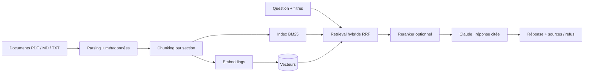

# RAG-BTP : recherche documentaire augmentée par LLM pour le BTP

Système de **RAG** (Retrieval-Augmented Generation) qui répond à des questions sur un corpus du bâtiment et des travaux publics (réglementation, documents techniques, procédures internes) **en citant ses sources**, et qui sait répondre « je ne trouve pas » quand l'information est absente.

>   Le mini-corpus a été téléchargé sur le net . 
## Ce que fait le projet

- **Ingestion** de PDF, Markdown et texte, avec détection des titres, extraction des tableaux et métadonnées (type, date, version, statut).
- **Chunking par section** avec chevauchement ; chaque passage garde son contexte (document + section).
- **Recherche hybride** BM25 + embeddings multilingues, fusionnés par RRF, avec 
- **Génération** par Claude avec citations numérotées, refus explicite si le corpus ne répond pas, signalement des versions contradictoires.
- **Évaluation** reproductible : hit@k, MRR, taux d'abstention.
- **Interface** Gradio, **CLI**, notebook Colab, tests automatisés.

## Architecture




## Corpus

| Dossier | Contenu | Versionné |
|---|---|---|
| `data/raw/process_interne/` | procédures  (réception, non-conformités, travaux en hauteur, règlement de sécurité v1 et v2) | oui |
| `data/raw/technique/` | plan de contrôle béton et fiche produit ( avec tableau) | oui |
| `data/raw/reglementation/` |  (Légifrance, OPPBTP, INRS, CCTP publics...) | non |


## Structure du dépôt

```
rag-btp/
├── configs/config.yaml        # paramètres du pipeline
├── data/
│   ├── raw/                   # corpus
│   └── index/                 # index généré (non versionné)
├── docs/                      # architecture, corpus, évaluation, éthique
├── eval/questions.jsonl       # jeu de questions d'évaluation
├── notebooks/colab_demo.ipynb # démo et tests sous Colab
├── src/rag_btp/               # ingestion, chunking, embeddings, index, retrieval,
│                              # generation, pipeline, evaluation, cli, app
├── tests/                     # pytest (sans modèle lourd)
└── .github/workflows/         # intégration continue
```

## Tests
```bash
pytest -q        #  tests : parsing, chunking, filtres, fusion RRF, baseline BM25

## Feuille de route
- [ ] Corpus public réel + jeu de 40-60 questions reformulées
- [ ] Comparaison chiffrée dense / hybride / reranker, et sensibilité à la taille des chunks
- [ ] OCR (Docling ou Tesseract) pour les PDF scannés
- [ ] Suivi des renvois entre articles
- [ ] Évaluation de la fidélité (juge LLM / RAGAS) et analyse d'erreurs
- [ ] Remplacement de NumPy par une base vectorielle (Qdrant, pgvector) si le corpus grossit


